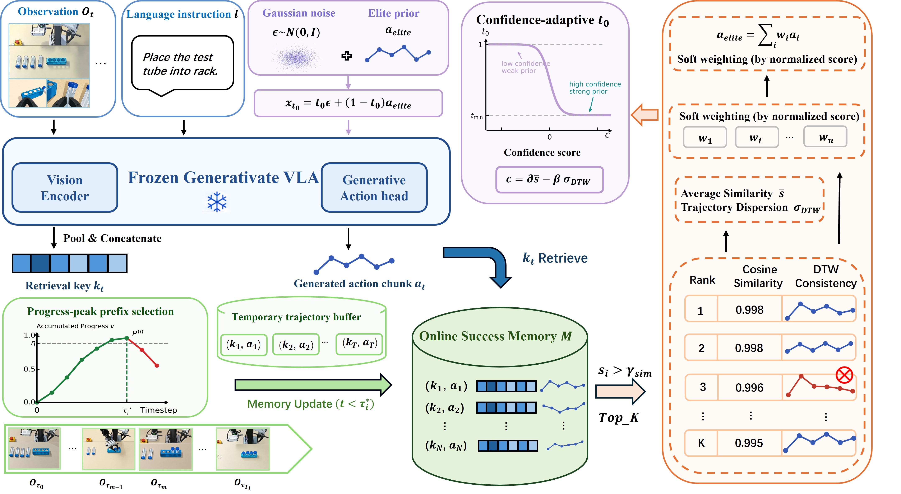

<div align="center">

<h1>Retrieve-then-Steer</h1>
<h3>Online Success Memory for Test-Time Adaptation of Generative VLAs</h3>

<p><strong>NeurIPS 2026</strong></p>
<p>Jianchao Zhao, Huoren Yang, Yusong Hu, Yuyang Gao, Qiguan Ou,<br>Cong Wan, SongLin Dong, Zhiheng Ma, Yihong Gong</p>
<p>Xi'an Jiaotong University · One Robotics · Shenzhen University of Advanced Technology</p>

<a href="https://arxiv.org/abs/2605.10094"></a>
<a href="LICENSE"></a>

</div>

[Paper](https://arxiv.org/abs/2605.10094) · [Overview](#overview) · [Getting started](#getting-started) · [VLAC](experiments/vlac/README.md) · [Citation](#citation) · [中文](README.zh-CN.md)

## Overview

**Can a frozen VLA become more reliable by reusing its own successful experience?**

Robots often repeat tasks in the same or slowly changing environment. A successful
execution therefore offers useful evidence about which behaviors work under local
conditions. Retrieve-then-Steer turns this experience into an online memory that
guides subsequent action generation, while keeping the VLA's parameters frozen.

<p align="center">
  
</p>

The framework connects three components:

1. **Build an online success memory.** A progress critic identifies reusable
   successful observation–action prefixes and adds them to memory during deployment.
2. **Retrieve a consistent action prior.** Visual features from the frozen VLA
   retrieve relevant action chunks. DTW filters inconsistent trajectories, and
   similarity-based weighting aggregates the remaining candidates into an elite prior.
3. **Steer action generation.** The prior initializes an intermediate state of the
   flow-matching sampler. Retrieval confidence controls the guidance strength, and
   the frozen VLA refines actions conditioned on the current observation and instruction.

Adaptation takes place through memory and inference, without policy parameter
updates. This repository provides the π0.5 LIBERO-10 implementation, including
baseline, memory + DTW, and VLAC-guided memory evaluation.

## Getting started

```bash
git clone https://github.com/ZJC25127/Retrieve-then-Steer.git
cd Retrieve-then-Steer
```

The runtime requires Linux, an NVIDIA GPU, CUDA and EGL. Policy inference,
LIBERO simulation and VLAC inference use separate Python environments.
Model checkpoints must be downloaded separately.

1. Install the policy and simulator environments following
   [experiments/README.md](experiments/README.md).
2. Download the official `pi05_libero` checkpoint.
3. Run an evaluation from the repository root:

```bash
export PI05_CKPT=/absolute/path/to/pi05_libero

openpi/.venv/bin/python experiments/scripts/run_libero.py \
  --method baseline --checkpoint "$PI05_CKPT" --policy-gpu 0

openpi/.venv/bin/python experiments/scripts/run_libero.py \
  --method dtw --checkpoint "$PI05_CKPT" --policy-gpu 0
```

For VLAC evaluation, install the critic environment and download `VLAC-8b` as
described in [experiments/vlac/README.md](experiments/vlac/README.md):

```bash
export VLAC_CKPT=/absolute/path/to/VLAC-8b

openpi/.venv/bin/python experiments/vlac/scripts/run_vlac_reference_libero.py \
  --checkpoint "$PI05_CKPT" --critic-checkpoint "$VLAC_CKPT" \
  --critic-python experiments/vlac/env/bin/python --policy-gpu 0 --critic-gpu 1
```

`--dry-run` prints the execution plan. `--tasks 0 --states 0,1` runs a
two-episode functional check.

## Repository structure

```text
Retrieve-then-Steer/
├── openpi/                         OpenPI source
│   └── third_party/libero/          LIBERO source and simulator assets
├── experiments/
│   ├── scripts/                    Policy adapters, memory, DTW, evaluation
│   ├── resources/                  Evaluation protocol and memory configuration
│   ├── runs/                       Baseline and memory + DTW results
│   ├── logs/                       Evaluator and policy logs
│   ├── results_summary.json
│   ├── per_task.csv
│   └── vlac/
│       ├── VLAC/                   VLAC source
│       ├── scripts/                Critic service, progress and admission logic
│       ├── configs/                Task-specific critic configurations
│       ├── references/             24 reference frames per task
│       ├── runs/                   Memory + DTW + VLAC results
│       └── logs/                   Evaluator and policy logs
├── assets/                         Paper figures
├── tools/                          Source verification
├── tests/                          CPU tests
├── provenance/                     Versions and file checksums
└── licenses/
```

## Acknowledgments

The following source dependencies are included in the repository. Their license
notices are retained in the corresponding directories and in `licenses/`.

| Directory | Source | Commit |
|---|---|---|
| `openpi/` | [Physical-Intelligence/openpi](https://github.com/Physical-Intelligence/openpi) | `215abfb217dbac7d5f1273282331b9b1866c0479` |
| `openpi/third_party/libero/` | [Lifelong-Robot-Learning/LIBERO](https://github.com/Lifelong-Robot-Learning/LIBERO) | `f78abd68ee283de9f9be3c8f7e2a9ad60246e95c` |
| `experiments/vlac/VLAC/` | [InternRobotics/VLAC](https://github.com/InternRobotics/VLAC) | `0f302d020555e320347c55b09431afe17ef5cdd4` |

Retrieval, sampler integration and evaluation adapters are located under
`experiments/scripts/`. Critic and progress-based admission adapters are under
`experiments/vlac/scripts/`.

## Citation

If you use Retrieve-then-Steer in your research, please cite:

```bibtex
@inproceedings{zhao2026retrievethensteer,
  title     = {Retrieve-then-Steer: Online Success Memory for Test-Time Adaptation of Generative VLAs},
  author    = {Zhao, Jianchao and Yang, Huoren and Hu, Yusong and Gao, Yuyang and Ou, Qiguan and Wan, Cong and Dong, SongLin and Ma, Zhiheng and Gong, Yihong},
  booktitle = {Advances in Neural Information Processing Systems},
  year      = {2026},
  url       = {https://arxiv.org/abs/2605.10094}
}
```

## License

Project code is licensed under [Apache-2.0](LICENSE). Dependency licenses and
asset attribution are listed in [THIRD_PARTY_NOTICES.md](THIRD_PARTY_NOTICES.md).
Model weights and datasets are subject to their respective provider terms.
