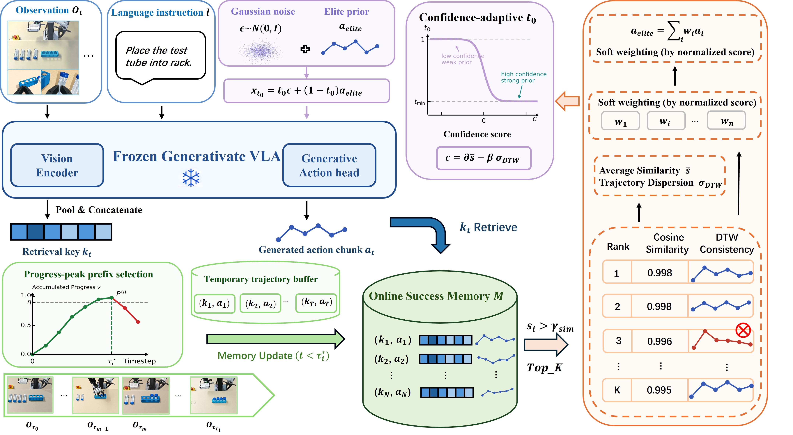

<div align="center">

<h1>Retrieve-then-Steer</h1>
<h3>Online Success Memory for Test-Time Adaptation of Generative VLAs</h3>

<p><strong>NeurIPS 2026</strong></p>
<p>Jianchao Zhao, Huoren Yang, Yusong Hu, Yuyang Gao, Qiguan Ou,<br>Cong Wan, SongLin Dong, Zhiheng Ma, Yihong Gong</p>
<p>Xi'an Jiaotong University · One Robotics · Shenzhen University of Advanced Technology</p>

<a href="https://arxiv.org/abs/2605.10094"></a>
<a href="LICENSE"></a>

</div>

[论文](https://arxiv.org/abs/2605.10094) · [方法概述](#方法概述) · [环境安装](#环境安装) · [VLAC](experiments/vlac/README.md) · [引用](#引用) · [English](README.md)

## 方法概述

**参数冻结的 VLA，能否通过复用自身的成功经验变得更可靠？**

机器人经常在相同或缓慢变化的环境中重复执行任务。一次成功的执行，能够为当前
场景下有效的行为提供依据。Retrieve-then-Steer 将这些经验积累为在线成功记忆，
用于引导后续动作生成，同时保持 VLA 的模型参数冻结。

<p align="center">
  
</p>

方法包含三个相互连接的部分：

1. **构建在线成功记忆。** 通过进度 critic 识别可复用的成功观测–动作前缀，
   在部署过程中将其写入记忆。
2. **检索一致的动作先验。** 利用冻结 VLA 的视觉特征检索相关动作块，
   通过 DTW 过滤不一致轨迹，再根据相似度加权聚合为精英动作先验。
3. **引导动作生成。** 用动作先验初始化 flow-matching 采样器的中间状态，
   根据检索置信度调整引导强度，由冻结 VLA 结合当前观测与指令继续生成动作。

适应过程通过记忆与推理完成，无需更新策略参数。本仓库提供 π0.5 在 LIBERO-10
上的实现，包括基线、memory＋DTW，以及使用 VLAC 进行记忆筛选的评测入口。

## 环境安装

```bash
git clone https://github.com/ZJC25127/Retrieve-then-Steer.git
cd Retrieve-then-Steer
```

运行环境为Linux、NVIDIA GPU、CUDA和EGL。策略推理、LIBERO仿真和VLAC推理
分别使用独立的Python环境：

| 组件 | Python版本 | 安装说明 |
|---|---:|---|
| OpenPI策略服务 | 3.11 | [安装与评测](experiments/README.md) |
| LIBERO仿真 | 3.8 | [安装与评测](experiments/README.md) |
| VLAC评分服务 | 3.10 | [VLAC配置](experiments/vlac/README.md) |

模型权重需单独下载。π0.5使用官方 `pi05_libero` checkpoint；VLAC评测还需
`InternRobotics/VLAC-8b`。下载路径及依赖安装命令见上述文档。

## 运行评测

以下命令在仓库根目录执行。

```bash
export PI05_CKPT=/absolute/path/to/pi05_libero

# 基线
openpi/.venv/bin/python experiments/scripts/run_libero.py \
  --method baseline --checkpoint "$PI05_CKPT" --policy-gpu 0

# memory＋DTW
openpi/.venv/bin/python experiments/scripts/run_libero.py \
  --method dtw --checkpoint "$PI05_CKPT" --policy-gpu 0
```

VLAC评测：

```bash
export VLAC_CKPT=/absolute/path/to/VLAC-8b

openpi/.venv/bin/python experiments/vlac/scripts/run_vlac_reference_libero.py \
  --checkpoint "$PI05_CKPT" --critic-checkpoint "$VLAC_CKPT" \
  --critic-python experiments/vlac/env/bin/python --policy-gpu 0 --critic-gpu 1
```

常用选项：

| 选项 | 作用 |
|---|---|
| `--dry-run` | 打印执行计划，不启动模型 |
| `--tasks 0 --states 0,1` | 运行指定任务的两个回合 |
| `--openpi-root` | 指定OpenPI源码目录 |
| `--policy-python`、`--env-python` | 指定策略和仿真环境的Python |
| `--output`、`--log-root` | 指定新结果和日志目录 |
| `--save-videos` | 保存评测视频 |
| `--save-trajectories` | 保存VLAC评测的无损NPZ轨迹 |

默认依次运行10个任务。每个memory任务从空记忆开始，在该任务的50回合内
在线累积。新结果保存至对应的 `runs/<method>_<timestamp>/`，日志保存至
`logs/<method>_<timestamp>/`。视频和无损轨迹默认不保存。

## 目录结构

```text
Retrieve-then-Steer/
├── openpi/                         OpenPI源码
│   └── third_party/libero/          LIBERO源码及仿真资产
├── experiments/
│   ├── scripts/                    策略适配、memory、DTW及评测入口
│   ├── resources/                  评测协议和memory参数
│   ├── runs/                       基线与memory＋DTW结果
│   ├── logs/                       评测及策略日志
│   ├── results_summary.json
│   ├── per_task.csv
│   └── vlac/
│       ├── VLAC/                   VLAC源码
│       ├── scripts/                评分服务、进度累计及入库逻辑
│       ├── configs/                各任务critic参数
│       ├── references/             每任务24张参考图
│       ├── runs/                   memory＋DTW＋VLAC结果
│       └── logs/                   评测及策略日志
├── assets/                         论文插图
├── tools/                          源码校验工具
├── tests/                          CPU测试
├── provenance/                     版本及文件校验记录
└── licenses/
```

## 致谢与源码来源

以下源码已包含在仓库中，并保留对应许可证：

| 目录 | 来源 | 提交版本 |
|---|---|---|
| `openpi/` | [Physical-Intelligence/openpi](https://github.com/Physical-Intelligence/openpi) | `215abfb217dbac7d5f1273282331b9b1866c0479` |
| `openpi/third_party/libero/` | [Lifelong-Robot-Learning/LIBERO](https://github.com/Lifelong-Robot-Learning/LIBERO) | `f78abd68ee283de9f9be3c8f7e2a9ad60246e95c` |
| `experiments/vlac/VLAC/` | [InternRobotics/VLAC](https://github.com/InternRobotics/VLAC) | `0f302d020555e320347c55b09431afe17ef5cdd4` |

检索和采样适配代码位于 `experiments/scripts/`；critic与进度入库适配代码
位于 `experiments/vlac/scripts/`。

## 引用

如在研究中使用 Retrieve-then-Steer，请引用：

```bibtex
@inproceedings{zhao2026retrievethensteer,
  title     = {Retrieve-then-Steer: Online Success Memory for Test-Time Adaptation of Generative VLAs},
  author    = {Zhao, Jianchao and Yang, Huoren and Hu, Yusong and Gao, Yuyang and Ou, Qiguan and Wan, Cong and Dong, SongLin and Ma, Zhiheng and Gong, Yihong},
  booktitle = {Advances in Neural Information Processing Systems},
  year      = {2026},
  url       = {https://arxiv.org/abs/2605.10094}
}
```

## 许可证

项目代码采用 [Apache-2.0](LICENSE)。依赖源码和资产来源见
[THIRD_PARTY_NOTICES.md](THIRD_PARTY_NOTICES.md)。模型权重与数据集遵循各自提供方条款。
